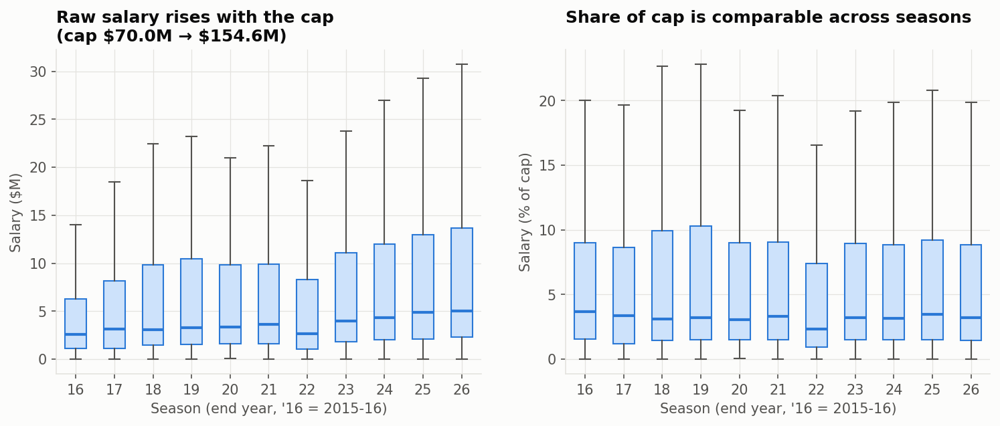
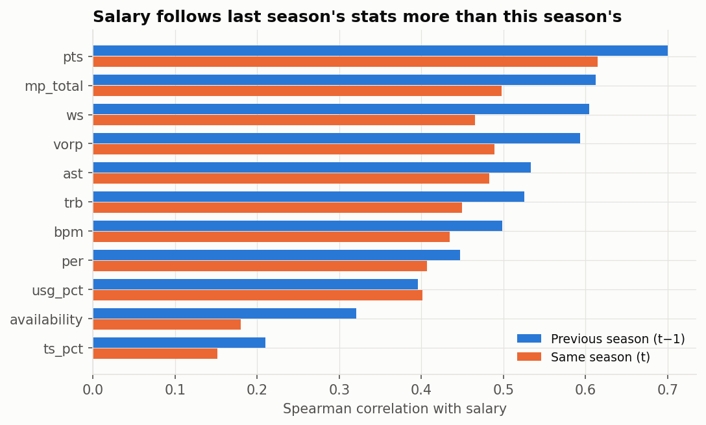
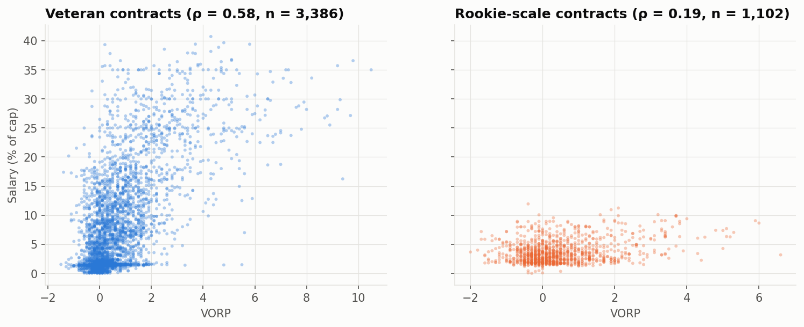
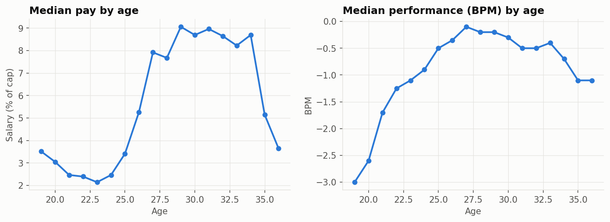
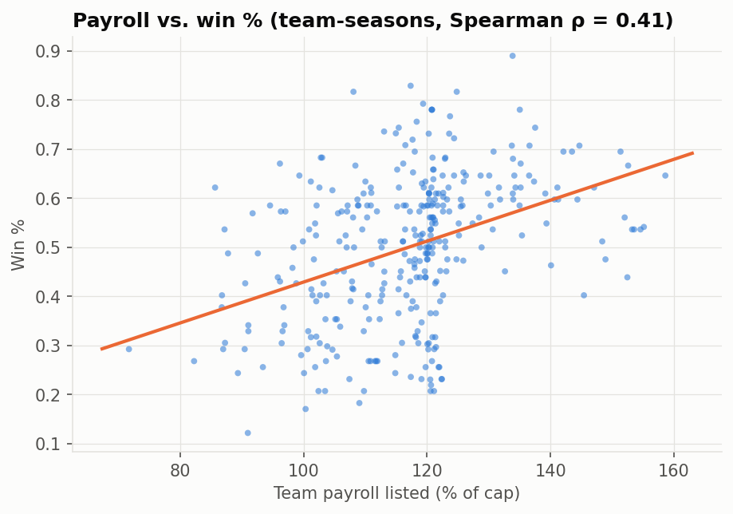
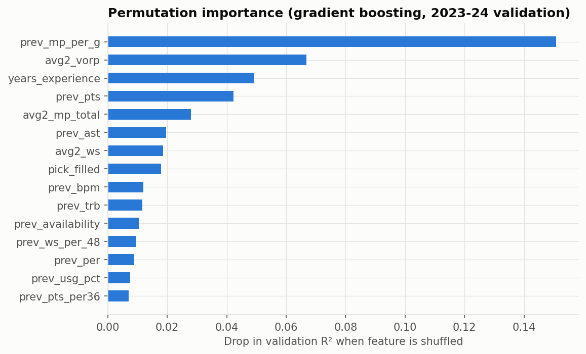

# Paid for What? How NBA Salaries Track Performance

DS 325 · EDA & Feature Engineering Checkpoint · Nov 18, 2026

**Team:** Gytis Gervickas · _[Teammate 2]_ · _[Teammate 3]_ · **Repo:** [github.com/gervickas/nba-salary-performance](https://github.com/gervickas/nba-salary-performance)

**Question:** What does the NBA pay for, and who is over- or underpaid?

**Plan:** predict salary from pre-season info → surplus value = actual − predicted pay → do teams with more surplus win more?

| Data collected | EDA | Features engineered | Features selected | Ready to model |
|:---:|:---:|:---:|:---:|:---:|
| ✅ | ✅ | ✅ | ✅ | ✅ |

## Data

- **Source:** Basketball-Reference.com, scraped by us (389 pages)
- **Coverage:** 11 seasons (2015-16 → 2025-26), all 30 teams
- **Size:** 5,968 player-seasons, 1,554 players; 91% matched to a salary
- **Tables:** stats, advanced stats, salaries, rosters, draft, salary cap, joined on player ID

## EDA findings

**1. Model salary as % of the cap.** The cap grew from \$70M to \$155M; as a share of it, salaries are stable. Log scale fixes the skew.

**2. Pay follows *last* season.** 10 of 11 stats correlate more with salary from the previous season.

**3. Rookie contracts are a separate market.** Their pay barely tracks production (ρ = 0.19 vs 0.58 for veterans).

**4. Pay lags the aging curve.** Performance peaks around 27; pay peaks at 29–34.

**5. Money buys wins, loosely.** Payroll vs. win %: ρ = 0.41 — room for *efficient* spending to matter.

## Feature engineering

| Feature | Why |
|---|---|
| Target: log(salary ÷ cap) | removes cap growth and skew |
| Previous-season and 2-season-average stats | contracts are priced on past seasons |
| Shrunk rate stats (PER, BPM, TS%, …) | low-minute seasons are noise |
| Availability, starts, All-Star / All-NBA | durability, role, reputation |
| Experience, draft pick, undrafted | career stage, pedigree |

**Filters:** ≥ 250 minutes; rookie-scale contracts modeled separately (pay set by draft slot, ρ = −0.89) → **2,833 player-seasons**.

**Split:** train 2016-17 → 2022-23 · validate 2023-24 · test 2024-25 and 2025-26 (untouched).

## Feature selection

Five methods (correlation, mutual information, VIF, Lasso, permutation importance); kept features with ≥ 3 votes and dropped near-duplicates → **36 → 21 features**.

Minutes/role, experience, draft pick, and 2-season VORP carry the signal. Points drop out: once minutes are known, they add little.

**Readiness check** (2023-24 season, not used in training):

| Model | R² | Avg. error |
|---|---:|---:|
| Predict the mean | 0.00 | 7.5% of cap (≈ \$10M) |
| Lasso, 21 features | 0.63 | 3.6% of cap |
| Gradient boosting, 21 features | **0.67** | **3.3% of cap (≈ \$4.5M)** |

## Next

1. Train and tune models; final test on 2024-25 and 2025-26.
2. Surplus value per player (actual − predicted pay).
3. Do teams with more surplus value win more?

_Code, data and full analysis: `notebooks/01–03`, `src/`, `data/`._
